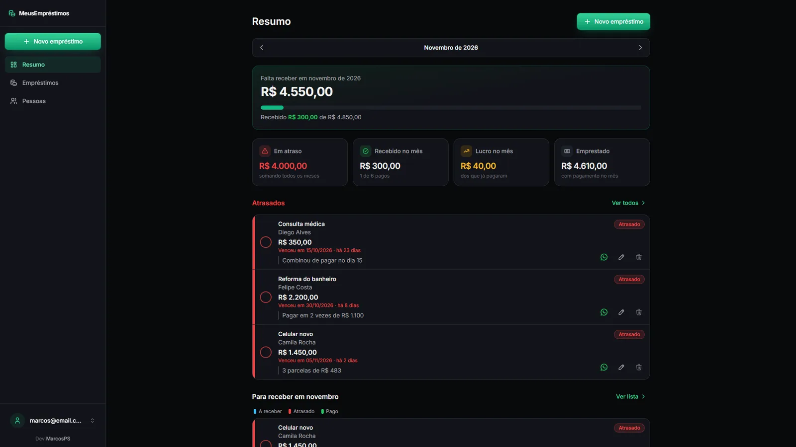
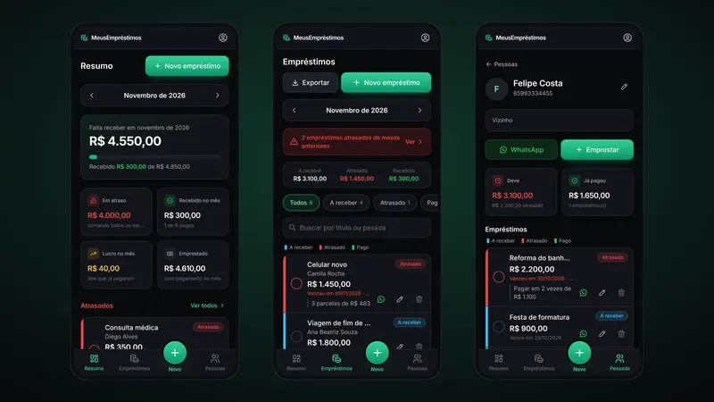
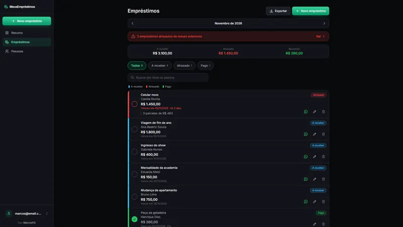
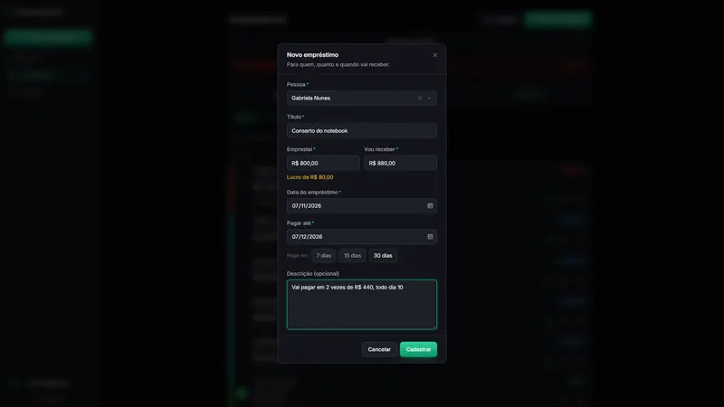
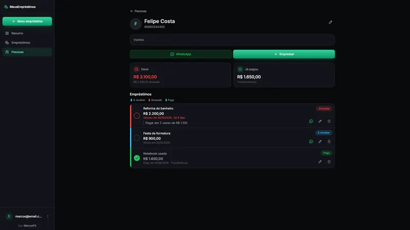
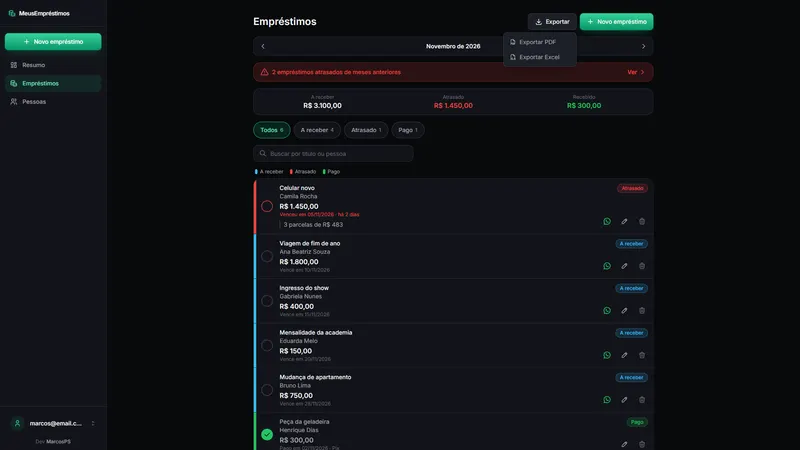

# MeusEmpréstimos — Controle de Empréstimos e Cobranças

Para quem, quanto e quando vai receber — com cobrança pronta no WhatsApp.

<p align="center">
  
</p>

> Repositório privado. Não compartilhe chaves, tokens ou arquivos `.env` fora do projeto.

---

## Sumário

- [Visão geral](#visão-geral)
- [Telas](#telas)
- [Como funciona](#como-funciona)
- [Recuperação de senha](#recuperação-de-senha)
- [Stack e versões](#stack-e-versões)
- [Estrutura do projeto](#estrutura-do-projeto)
- [Primeiros passos](#primeiros-passos)
- [Configuração do Supabase](#configuração-do-supabase)
- [Variáveis de ambiente](#variáveis-de-ambiente)
- [Scripts](#scripts)
- [Deploy](#deploy)
- [Autor](#autor)

---

## Visão geral

Aplicativo pessoal, pensado primeiro para o celular, para controlar dinheiro emprestado. Cada empréstimo tem pessoa, valor emprestado, valor a receber (a diferença vira lucro), data combinada e descrição livre. O status é calculado automaticamente (a receber, atrasado ou pago) e os atrasados de meses anteriores ficam em destaque até serem quitados. Um toque abre o WhatsApp com a mensagem de cobrança já escrita. Resumo mensal com gráfico e exportação em PDF e Excel.

Principais funcionalidades:

- Status automático: a receber, atrasado ou pago
- Cobrança pelo WhatsApp com mensagem pronta
- Resumo do mês com lucro, atrasos e gráfico
- Layout mobile-first com navegação inferior
- Exportação em PDF e Excel sob demanda

Concluído em 09/2026.

---

## Telas

Todas as telas usam dados fictícios.

<table>
  <tr>
    <td width="50%"><br><sub>Versão mobile do aplicativo</sub></td>
    <td width="50%"><br><sub>Lista de empréstimos com filtros por status</sub></td>
  </tr>
  <tr>
    <td width="50%"><br><sub>Cadastro de empréstimo com cálculo de lucro</sub></td>
    <td width="50%"><br><sub>Página da pessoa com saldo devedor e WhatsApp</sub></td>
  </tr>
  <tr>
    <td width="50%"><br><sub>Exportação em PDF e Excel</sub></td>
  </tr>
</table>

---

## Como funciona

- **Empréstimo** tem título, pessoa, valor emprestado, valor a receber (igual ao emprestado
  por padrão; se for maior, a diferença aparece como lucro), data do empréstimo, data combinada
  de pagamento e uma descrição livre (ex.: "3 parcelas de R$ 200").
- **Status** (calculado automaticamente):
  - **A receber**: ainda está no prazo.
  - **Atrasado**: a data passou e o empréstimo não foi pago.
  - **Pago**: foi marcado no check, com a data do pagamento e a forma (Pix, dinheiro...), que é opcional.
- **Pessoas** têm nome, WhatsApp e observações. Dá para cadastrar a pessoa direto no
  formulário do empréstimo.
- **WhatsApp**: o botão verde abre a conversa com a mensagem de cobrança já escrita
  (título, valor e data). É só apertar enviar.
- **Resumo (dashboard)** e **lista** navegam por mês (mês da data de pagamento). Os atrasados
  de meses anteriores aparecem em destaque até serem pagos.

Design system e regras de UI/UX mobile: [`docs/design-system.md`](docs/design-system.md).

---

## Recuperação de senha

A tela de login usa o e-mail embutido do Supabase Auth (`resetPasswordForEmail`), sem precisar
configurar SMTP. Ele envia poucos e-mails por hora e pode cair no spam. Se precisar de mais,
configure um SMTP em **Authentication → Settings → SMTP Settings**, sem mudar nada no código.
O link do e-mail leva para `/redefinir-senha`.

---

## Stack e versões

| Categoria | Tecnologia | Versão |
| --- | --- | --- |
| Linguagem | TypeScript | 6.0 |
| UI | React | 19.2 |
| Build | Vite | 8.1 |
| Rotas | React Router | 8.3 |
| Estilo | Tailwind CSS | 4.3 |
| Componentes | Radix UI + CVA | 1.1 / 0.7 |
| Back-end | Supabase | 2.111 |
| Dados | TanStack Query | 5.101 |
| Formulários | React Hook Form | 7.83 |
| Validação | Zod | 4.4 |
| Gráficos | Recharts | 3.10 |
| Documentos | ExcelJS + jsPDF | 4.4 / 4.2 |
| Animação | OGL (WebGL) | 1.0 |
| Ícones | Iconify | 6.0 |
| Datas | date-fns | 4.4 |
| Qualidade | ESLint + Prettier | 10.8 / 3.9 |

As versões exatas estão no `package.json`.

---

## Estrutura do projeto

```
src/
  app/
    AppLayout.tsx
    RequireAuth.tsx
    providers.tsx
    router.tsx
  components/
    charts/
    effects/
    layout/
    shared/
    ui/
  constants/
    app.ts
    nav.ts
  context/
    AuthContext.tsx
  features/
    auth/
    dashboard/
    loans/
    people/
  hooks/
    useMonthParam.ts
  lib/
    excel/
    pdf/
    cn.ts
    device.ts
    format.ts
    queryClient.ts
    reportColumn.ts
    supabase.ts
    … (+1)
  types/
    database.ts
  App.tsx
  index.css
  main.tsx
  vite-env.d.ts
```

---

## Primeiros passos

### Pré-requisitos

- Node.js 20.19 ou mais recente
- npm

### Instalação

```bash
git clone https://github.com/marcospsdev/emprestimos-cobrancas.git
cd emprestimos-cobrancas
npm install
cp .env.example .env.local   # preencha os valores (veja abaixo)
npm run dev               # http://localhost:5173
```

---

## Configuração do Supabase

1. Crie um projeto em [supabase.com](https://supabase.com) (o plano gratuito é suficiente).
2. No **SQL Editor**, cole e execute o conteúdo de `supabase-schema.sql`. Ele cria as tabelas, as regras de segurança (RLS) e o que mais o app usa.
3. Em **Authentication → Users → Add user**, crie o usuário que vai entrar no sistema (o app não tem tela de cadastro).
4. Em **Settings → API**, copie a **Project URL** e a chave **anon public** para as variáveis de ambiente. Nunca use a chave `service_role` no front-end.

---

## Variáveis de ambiente

Baseie-se no `.env.example`. Nunca commite o `.env.local` nem arquivos com valores reais.

| Variável | Obrigatória | Descrição |
| --- | --- | --- |
| `VITE_SUPABASE_URL` | Sim | URL do projeto no Supabase (**Settings → API → Project URL**) |
| `VITE_SUPABASE_ANON_KEY` | Sim | Chave pública `anon` do Supabase |

---

## Scripts

| Comando | Descrição |
| --- | --- |
| `npm run dev` | Servidor de desenvolvimento (Vite) |
| `npm run build` | Typecheck e build de produção em `dist/` |
| `npm run lint` | Analisa o código com o ESLint |
| `npm run preview` | Serve o build de produção localmente |

---

## Deploy

1. Importe o repositório na [Vercel](https://vercel.com) (o Vite é detectado automaticamente).
2. Build: `npm run build` · saída: `dist`.
3. Cadastre as variáveis de ambiente em **Settings → Environment Variables** (se houver) e faça o deploy.

O `vercel.json` redireciona todas as rotas para o `index.html`, então as rotas do React funcionam ao recarregar a página.

---

## Autor

**Marcos Paulo** · Desenvolvedor Full-Stack

- LinkedIn: [in/marcospsdev](https://www.linkedin.com/in/marcospsdev)
- GitHub: [@marcospsdev](https://github.com/marcospsdev)
